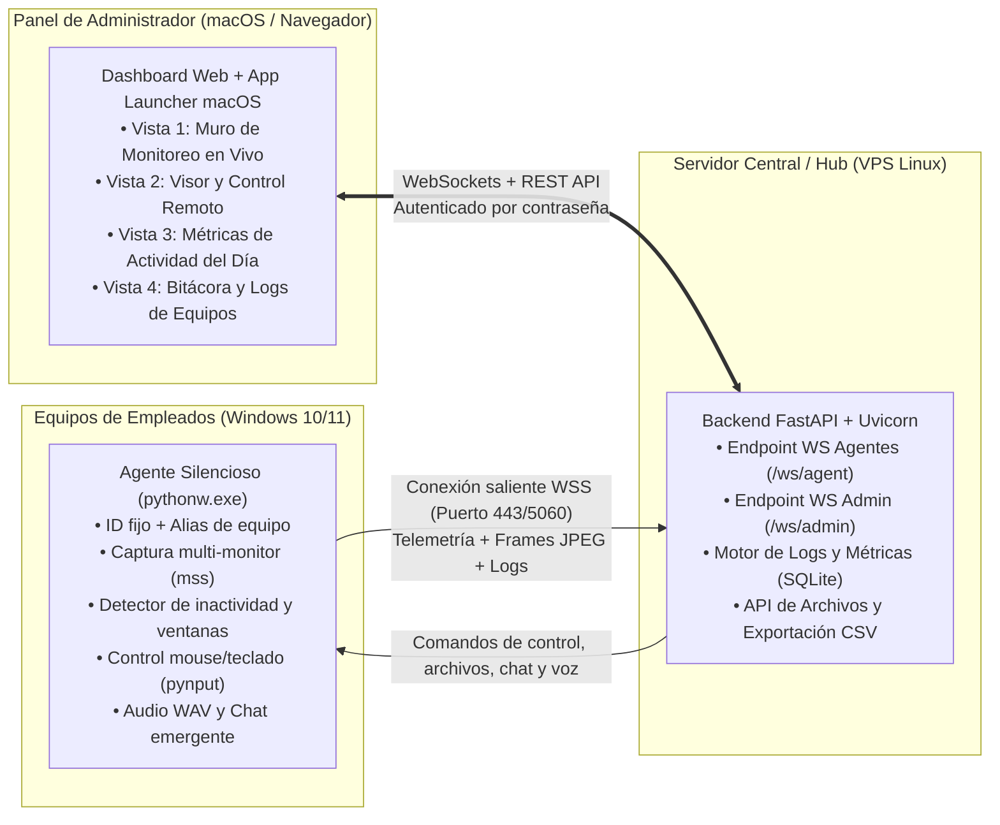

# Especificación Técnica y Planeación del Proyecto: Sistema Corporativo de Monitoreo de Actividad y Asistencia Remota Silenciosa

**Rol del documento:** Especificación técnica integral (PRD + Arquitectura + Contratos de Datos + Roadmap por Fases) diseñada para ser ejecutada por un desarrollador asistido por IA.

---

## 1. Resumen Ejecutivo y Objetivos del Negocio

Se requiere desarrollar una plataforma propia en **Python** para **monitorear la actividad en tiempo real (estilo Microsoft Teams)** y **brindar asistencia remota silenciosa** a las computadoras Windows de la empresa (tanto equipos en red local de oficina como laptops remotas fuera de la oficina), administrada desde una consola central en **macOS / Web**.

### 1.1 Reglas de Oro del Sistema (Requerimientos No Negociables)
1. **No cerrar ni bloquear jamás la sesión del empleado:** A diferencia del protocolo RDP (que bloquea el monitor físico de Windows), el cliente debe correr dentro de la sesión activa del usuario, permitiendo observar y controlar su pantalla en tiempo real mientras el empleado sigue viendo su escritorio.
2. **Conexión 100% silenciosa y sin pedir confirmación:** A diferencia de TeamViewer o AnyDesk, cuando el administrador se conecta a visualizar o controlar un equipo, **no debe aparecer ningún aviso, cartel de confirmación ni notificación** en la pantalla del empleado.
3. **Sin dependencia de direcciones IP de los empleados:** Los equipos de los empleados tienen IPs dinámicas y están detrás de módems domésticos o firewalls. El cliente de cada PC debe iniciar una **conexión saliente persistente (`WebSocket`)** hacia el Servidor Central (VPS), identificándose con un ID único de equipo y un alias amigable (ej. `"PC de Miguel - Administración"`).
4. **Compatibilidad total con McAfee Antivirus y Windows SmartScreen:**
   * **Prohibido compilar el cliente con PyInstaller/cx_Freeze sin firma digital** o usar scripts `.vbs` de arranque, ya que disparan alertas heurísticas y de "Editor desconocido" en McAfee.
   * El agente debe ejecutarse utilizando directamente el binario oficial **`pythonw.exe`** (instalador oficial de Python.org, el cual ya cuenta con firma digital legítima de la *Python Software Foundation* y corre sin ventana de consola).
5. **Interfaz Gráfica Profesional (Cero Emojis, 100% Iconos Vectoriales SVG):**
   * Queda **estrictamente prohibido el uso de emojis** en la interfaz de usuario, botones, estados, logs o notificaciones.
   * Todos los indicadores visuales y botones deben utilizar exclusivamente **iconos vectoriales SVG** limpios (estilo Lucide Icons o Heroicons) e indicadores geométricos CSS.

---

## 2. Arquitectura del Sistema



### 2.1 Estructura de Directorios del Proyecto

```text
RemoteAssist/
├── server/
│   ├── app.py                    # Servidor FastAPI, rutas HTTP y gestores WebSocket
│   ├── config.py                 # Variables de entorno (Puerto, Clave Admin, Token Agente)
│   ├── database.py               # Capa de persistencia SQLite (Equipos, Logs, Métricas, Chat)
│   ├── models.py                 # Esquemas Pydantic y estructuras de control
│   ├── requirements.txt          # Dependencias del servidor
│   ├── templates/
│   │   └── index.html            # SPA del Panel de Administrador (4 vistas, iconos SVG)
│   └── static/
│       ├── css/
│       │   └── styles.css        # Estilos oscuros corporativos y componentes UI
│       └── js/
│           ├── app.js            # Lógica de navegación, filtros, métricas y bitácora de logs
│           ├── viewer.js         # Renderizado Canvas 2D, captura de mouse/teclado y zoom
│           └── audio.js          # Captura de micrófono (WebAudio) a paquetes WAV (Push-to-Talk)
├── agent/
│   ├── agent.py                  # Cliente silencioso para Windows (ejecutado con pythonw.exe)
│   ├── config_agent.json         # Configuración local (URL del servidor, Token, Alias, UUID)
│   ├── requirements-agent.txt    # Dependencias ligeras (websockets, mss, Pillow, pynput, pyperclip)
│   ├── install_windows.bat       # Instalador que registra la tarea programada con pythonw.exe
│   └── uninstall_windows.bat     # Desinstalador limpio de tarea programada
├── macos_launcher/
│   ├── Abrir Panel.command       # Script de acceso rápido para macOS
│   └── Remote Assist.app/        # Bundle nativo para abrir el panel desde el Dock de macOS
├── Dockerfile                    # Despliegue contenedorizado para el VPS
└── docker-compose.yml            # Orquestación con volumen persistente para SQLite
```

---

## 3. Especificación Funcional Detallada por Componente

### 3.1 Componente 1: Agente Silencioso de Windows (`agent/agent.py`)

1. **Ejecución Invisible y Autoinicio Limpio (Compatible con McAfee):**
   * Los archivos del agente se instalan en `C:\ProgramData\MonitoreoEmpresa\`.
   * El instalador (`install_windows.bat`) detecta la ruta de `pythonw.exe` oficial y crea una entrada en el Programador de Tareas de Windows (`schtasks /create /tn "ServicioMonitoreoCorporativo" /tr "\"C:\...\pythonw.exe\" \"C:\ProgramData\MonitoreoEmpresa\agent.py\"" /sc onlogon /rl highest /f`) o en `HKCU\Software\Microsoft\Windows\CurrentVersion\Run`.
   * Al instalar en cada PC, se agrega la carpeta `C:\ProgramData\MonitoreoEmpresa\` a las exclusiones de análisis en tiempo real de McAfee.

2. **Identificación Única del Equipo (Sin depender de IPs):**
   * En su primera ejecución, el agente obtiene el identificador único de hardware (`uuid.getnode()` / serial de placa base) y lo guarda en `config_agent.json` junto con un `alias` configurable (ej. `"PC de Miguel"`), `hostname`, `username` de Windows e IP local informativa.
   * Si la conexión a internet cae o la PC cambia de red/IP, el bucle asíncrono reintenta la conexión cada 4 segundos automáticamente.

3. **Corrección Obligatoria de Escalado DPI en Windows:**
   * Al inicio del script en Windows, se debe invocar obligatoriamente:
     ```python
     ctypes.windll.shcore.SetProcessDpiAwareness(2)  # Per-Monitor DPI Aware
     ```
   * Esto garantiza que en laptops con zoom de pantalla al 125% o 150%, las coordenadas capturadas por `mss` coincidan exactamente con las coordenadas físicas de `SetCursorPos` / `pynput`.

4. **Motor de Telemetría de Actividad (Estilo Microsoft Teams):**
   * Cada **4 segundos**, el agente consulta dos APIs nativas de Windows mediante `ctypes.windll.user32`:
     * **Tiempo de Inactividad (`GetLastInputInfo`):** Calcula cuántos segundos exactos lleva el usuario sin tocar el teclado ni mover el mouse:
       $$\text{idle\_seconds} = \lfloor (\text{GetTickCount}() - \text{lastInputInfo.dwTime}) / 1000 \rfloor$$
     * **Ventana y Aplicación Activa (`GetForegroundWindow` + `GetWindowTextW`):** Obtiene el título de la ventana que el empleado tiene en primer plano (ej. `"Microsoft Excel - Reporte.xlsx"`).
   * **Detección inteligente de eventos para Logs:**
     * Si el título de la ventana activa cambia respecto a la lectura anterior, el agente envía un evento de log `WINDOW_CHANGE` indicando la nueva ventana, la ventana anterior y cuántos segundos permaneció en la anterior.
     * Si `idle_seconds` cruza el umbral de inactividad (ej. 180 segundos), envía un evento `IDLE_START`. Cuando vuelve a `0`, envía `ACTIVE_RESUME` con la duración total de la ausencia.

5. **Captura de Pantalla Multi-Monitor y Streaming Bajo Demanda:**
   * **Modo Reposo (Cuando el administrador está en el Muro General):** El agente consume 0% de ancho de banda de video continuo; únicamente envía una miniatura comprimida (`420x240`, JPEG calidad 50) cada **12 segundos** junto con la telemetría.
   * **Modo Streaming Activo (Cuando el administrador entra al Visor de esa PC):** El servidor envía `{"type": "start_stream"}` y el agente transmite entre **15 y 25 FPS** del monitor seleccionado (`monitor_id = 1..N` o `0` para todos los monitores combinados).
   * Incluye en la cabecera de cada cuadro las coordenadas relativas del cursor del empleado (`cx`, `cy`) para dibujarlo en el visor del administrador.

6. **Inyección de Mouse, Teclado y Atajos:**
   * Soporta movimiento, clic izquierdo, derecho, central, doble clic, arrastrar y soltar (`mousedown` / `mouseup`), rueda de scroll vertical/horizontal y pulsaciones de teclado incluyendo teclas especiales (`Enter`, `Backspace`, `Tab`, `Escape`, `Delete`, flechas, `F1`–`F12`, `Ctrl`, `Alt`, `Shift`, `Win`) y atajos rápidos (`Ctrl+C`, `Ctrl+V`, `Alt+Tab`, `Win+D`, `Ctrl+Shift+Esc`).

7. **Comunicación Directa y Utilidades de Asistencia:**
   * **Voz en Directo (Push-to-Talk):** Recibe bloques binarios de audio WAV desde el micrófono del administrador y los reproduce de inmediato en las bocinas/audífonos de la PC usando `winsound.PlaySound(wav_bytes, winsound.SND_MEMORY)` (100% nativo de Windows, sin requerir compilar `PyAudio`).
   * **Ventana de Chat Emergente Bajo Demanda:** Permanece cerrada e invisible mientras el administrador solo observa. Únicamente cuando el administrador envía un mensaje de chat, se despliega una ventana `tkinter` con atributo `-topmost True` y sonido de notificación (`winsound.MessageBeep`), permitiendo al empleado leer el mensaje y responder en tiempo real.
   * **Portapapeles Bidireccional:** Permite leer el texto copiado por el empleado (`get_clipboard`) o inyectar texto desde la Mac al portapapeles de la PC (`set_clipboard`) con opción de pegado automático (`Ctrl+V`).
   * **Recepción de Archivos:** Recibe archivos enviados por el administrador y los guarda directamente en `Desktop` (Escritorio) o `Downloads` (Descargas), con opción de ejecutarlos/abrirlos automáticamente (`os.startfile`) al finalizar la descarga.

---

### 3.2 Componente 2: Servidor Central y Base de Datos (`server/`)

1. **Gestión de Conexiones en Tiempo Real (`HubManager`):**
   * Mantiene en memoria el diccionario de agentes conectados (`agent_id -> AgentConnection`) y el conjunto de sesiones de administrador activas.
   * Controla automáticamente el encendido y apagado del stream de video de cada agente: si ningún administrador está viendo en vivo a `PC-01`, le envía `stop_stream` para ahorrar CPU y red.

2. **Persistencia en Base de Datos (`SQLite` - `database.py`):**
   El servidor debe almacenar la información en un archivo local `data/remote_assist.db` con las siguientes 4 tablas:

   * **Tabla `devices` (Catálogo de Equipos):**
     * `agent_id` (TEXT PRIMARY KEY) — UUID único del equipo.
     * `alias` (TEXT) — Nombre asignado por el administrador (ej. `"PC de Miguel - Dirección"`).
     * `hostname` (TEXT), `username` (TEXT), `os_version` (TEXT), `local_ip` (TEXT).
     * `is_online` (INTEGER), `last_seen_at` (DATETIME).
   * **Tabla `device_logs` (Bitácora Histórica de Eventos):**
     * `id` (INTEGER PRIMARY KEY AUTOINCREMENT).
     * `timestamp` (DATETIME DEFAULT CURRENT_TIMESTAMP).
     * `agent_id` (TEXT), `hostname` (TEXT), `username` (TEXT).
     * `category` (TEXT) — Valores permitidos: `NETWORK` (conexión/desconexión), `IDLE` (inicio de inactividad / ausencia), `RESUME` (regreso a actividad), `WINDOW` (cambio de aplicación/ventana activa), `AUDIT` (conexión de soporte, archivo enviado, chat).
     * `message` (TEXT) — Descripción detallada del evento.
     * `duration_seconds` (INTEGER NULL) — Duración del estado previo (ej. segundos que duró en la ventana anterior o segundos que estuvo inactivo).
   * **Tabla `window_usage_daily` (Métricas Diarias por Aplicación):**
     * `date` (TEXT — `YYYY-MM-DD`), `agent_id` (TEXT), `app_name` (TEXT), `total_seconds` (INTEGER).
   * **Tabla `daily_activity_summary` (Resumen Diario Tipo Teams):**
     * `date` (TEXT), `agent_id` (TEXT), `first_seen_at` (DATETIME), `active_seconds` (INTEGER), `idle_seconds` (INTEGER), `away_alerts_count` (INTEGER).

---

### 3.3 Componente 3: Panel de Administrador (`templates/index.html` + `static/`)

El panel debe ser una aplicación web de una sola página (SPA) rápida, en modo oscuro corporativo, protegida por contraseña y estructurada en **4 vistas principales** navegables desde la barra superior (usando exclusivamente iconos SVG):

#### Vista 1: Muro de Monitoreo en Vivo (Grid / CCTV + Estado tipo Teams)
* **Contadores Superiores:** Total de equipos **Activos ahora** (Verde), **Inactivos 3–10 min** (Ámbar), **Ausentes +15 min** (Rojo) y **Desconectados** (Gris).
* **Filtros Rápidos:** Botones para filtrar la cuadrícula por estado (`Todos`, `Activos`, `Inactivos`, `Ausentes`) y buscador por nombre/alias.
* **Tarjetas por Equipo:**
  * Indicador luminoso de estado, nombre/alias editable, hostname, ubicación y cantidad de monitores.
  * **Etiqueta de Ventana Activa:** Muestra con icono SVG qué aplicación y documento tiene abierto en este segundo.
  * **Miniatura en Vivo:** Imagen del escritorio que se actualiza cada 10–15 segundos.
  * **Contador de Inactividad:** Muestra `"Actividad: hace 2 seg"` o alerta en rojo `"Inactivo: hace 24 min"`.
  * **Botones de Acción Rápida:** `Conectar` (abre el visor en modo silencioso), `Logs` (abre la bitácora filtrada para esa PC) y `Chat` (abre el visor enfocando el cuadro de mensaje).

#### Vista 2: Visor y Asistencia Remota Individual
* **Modo Inicial Seguro:** Al entrar a cualquier PC, el visor inicia siempre en **`Modo: Solo Observar`** (el mouse y teclado del administrador NO se envían a la PC hasta que el administrador pulse el botón para activar **`Modo: Controlar Mouse y Teclado`**).
* **Barra de Herramientas del Visor:**
  1. **Selector de Monitores:** Desplegable dinámico con los monitores reales reportados por esa PC (`Monitor 1`, `Monitor 2`, `Todos los monitores`) y selector de calidad/FPS.
  2. **Interruptor Solo Observar / Controlar:** Cambia de color (Verde = Observando en silencio, Ámbar = Controlando equipo) y habilita los eventos de `<canvas>`.
  3. **Botón `Mantener para Hablar` (Push-to-Talk):** Mientras se mantiene presionado, captura el micrófono de la Mac y envía el audio a las bocinas del empleado.
  4. **Cajón de Portapapeles:** Permite leer el portapapeles de la PC remota o enviarle texto desde la Mac (con opción de enviar `Ctrl+V` automático).
  5. **Cajón de Envío de Archivos:** Subida por clic o *Drag & Drop* hacia el `Escritorio` o `Descargas` del empleado, con casilla para abrir el archivo automáticamente al terminar.
  6. **Atajos de Soporte:** Botones para enviar `Administrador de Tareas (Ctrl+Shift+Esc)`, `Mostrar Escritorio (Win+D)` o `Cambiar Ventana (Alt+Tab)`.
* **Panel Lateral de Mensajes Directos:**
  * Botones de **1 clic** con mensajes predefinidos:
    * *"Hola, vi tu equipo sin actividad, ¿todo está bien?"*
    * *"Hola, ¿requieres ayuda con el sistema o algún reporte?"*
    * *"Voy a mover tu mouse un momento para ayudarte."*
  * Historial de conversación en vivo con el empleado.

#### Vista 3: Métricas de Actividad del Día
* Tabla comparativa por empleado y selector de fecha con:
  * Hora de primer encendido del día (`Inicio de Jornada`).
  * **Tiempo Activo Acumulado** vs **Tiempo Inactivo Acumulado**.
  * Cantidad de alertas por ausencias mayores a 15 minutos.
  * **Desglose porcentual de aplicaciones más usadas** en el día (ej. `Excel 65%`, `CONTPAQi 25%`, `Chrome 10%`).

#### Vista 4: Bitácora y Logs de Equipos
* Tabla cronológica en tiempo real alimentada por la tabla `device_logs` de SQLite.
* **Filtros:**
  * Selector por Equipo (`Todos los equipos` o un equipo específico).
  * Selector por Categoría (`Todas`, `Alertas de Inactividad`, `Cambio de Ventana / App`, `Conexión / Encendido`, `Auditoría de Soporte`).
  * Buscador por palabra clave (ej. filtrar dónde aparezca `"WhatsApp"`, `"Excel"`, `"Inactivo"`).
  * Botón **`Exportar CSV`** para descargar los logs filtrados.

---

## 4. Protocolo de Comunicación (Contratos WebSocket)

### 4.1 Formato de Paquete Binario de Video (Agente -> Servidor -> Admin)
Para máxima velocidad y mínimo consumo de ancho de banda, cada cuadro de video se envía como un mensaje binario (`bytes`) por WebSocket con la siguiente estructura:
* **Bytes `0..3` (`uint32` Big-Endian):** Longitud $N$ de la cabecera JSON.
* **Bytes `4..4+N` (UTF-8 JSON):**
  ```json
  {"m": 1, "w": 1920, "h": 1080, "cx": 0.4512, "cy": 0.6230}
  ```
  Donde `m` es el índice del monitor, `w` y `h` la resolución original, y `cx`, `cy` la posición normalizada (`0.0` a `1.0`) del cursor de la PC.
* **Bytes `4+N` hasta el final:** Bytes puros de la imagen comprimida en formato `JPEG`.

### 4.2 Mensajes JSON Principales (Agente <-> Servidor)

```json
// 1. Registro inicial del Agente al conectarse
{
  "type": "register",
  "token": "ra-secret-token-2026",
  "agent_id": "a1b2c3d4e5f6",
  "alias": "PC de Miguel - Dirección",
  "hostname": "DESKTOP-MIGUEL",
  "username": "miguel",
  "os": "Windows 11 Pro",
  "local_ip": "192.168.1.45",
  "monitors": [
    {"id": 0, "label": "Ambos Monitores", "left": 0, "top": 0, "width": 3840, "height": 1080},
    {"id": 1, "label": "Monitor 1 (1920x1080)", "left": 0, "top": 0, "width": 1920, "height": 1080}
  ],
  "idle_seconds": 0,
  "active_window": "Microsoft Excel - Presupuesto.xlsx",
  "thumbnail": "<base64_jpeg>"
}

// 2. Reporte periódico de Telemetría y Eventos de Log (cada 4s)
{
  "type": "telemetry",
  "idle_seconds": 245,
  "active_window": "Google Chrome - CRM Corporativo",
  "current_monitor": 1,
  "thumbnail": "<base64_jpeg_opcional_cada_12s>",
  "log_events": [
    {
      "category": "WINDOW",
      "message": "Cambió a 'Google Chrome - CRM Corporativo' (permanencia previa en Excel: 14m 20s)",
      "prev_app": "Microsoft Excel",
      "duration_seconds": 860
    }
  ]
}
```

---

## 5. Plan de Desarrollo por Fases (Roadmap para el Desarrollador)

Para garantizar entregas limpias y fáciles de probar, el desarrollo debe ejecutarse en **4 fases secuenciales**:

### Fase 1: Núcleo de Conexión Inversa, Visor Multi-Monitor y Control Remoto (MVP)
* **Alcance:**
  * Configurar el servidor `FastAPI` con endpoints `/ws/agent` y `/ws/admin`.
  * Programar `agent/agent.py` con identificación única (`UUID` + Alias), corrección de escala DPI (`SetProcessDpiAwareness`), captura multi-monitor con `mss` y control de mouse/teclado con `pynput`.
  * Construir la **Vista 1 (Muro básico)** y **Vista 2 (Visor en vivo)** con selector de monitores y el interruptor **`Modo: Solo Observar`** vs **`Modo: Controlar Mouse y Teclado`**.
* **Criterio de Aceptación:**
  * Ejecutar el agente en una PC de prueba, verla aparecer en el panel sin configurar IPs, entrar en silencio sin bloquear su sesión de Windows, alternar entre monitores y mover su mouse/teclado con precisión exacta.

### Fase 2: Motor de Monitoreo Tipo Teams, Base de Datos SQLite y Vista de Logs
* **Alcance:**
  * Integrar en el agente la lectura de `GetLastInputInfo` (segundos inactivos) y `GetForegroundWindow` (ventana activa y tiempo de permanencia por programa).
  * Implementar `server/database.py` con las tablas SQLite (`devices`, `device_logs`, `window_usage_daily`, `daily_activity_summary`).
  * Construir la **Vista 3 (Métricas de Actividad del Día)** y la **Vista 4 (Bitácora y Logs de Equipos)** con filtros por PC, categoría, buscador y exportación a CSV.
  * Configurar el semáforo automático (Verde < 3 min, Ámbar 3–10 min, Rojo > 10–15 min).
* **Criterio de Aceptación:**
  * Dejar una PC sin mover el mouse durante 3 minutos y verificar que la tarjeta cambie a Ámbar/Rojo, que se registre el evento `IDLE` en la pestaña de Logs y que cada cambio de ventana quede registrado con su duración en SQLite.

### Fase 3: Herramientas de Asistencia (Voz Push-to-Talk, Chat Emergente, Portapapeles y Archivos)
* **Alcance:**
  * Implementar captura de micrófono en el navegador (`audio.js`) enviando paquetes WAV al agente y reproduciéndolos con `winsound.PlaySound(..., SND_MEMORY)`.
  * Implementar la ventana emergente de chat en `tkinter` (`topmost`) que solo se abre en la PC del empleado cuando el administrador envía un mensaje (incluyendo los botones de mensajes rápidos de 1 clic).
  * Implementar sincronización de portapapeles (`pyperclip`) y el endpoint `/api/send-file/{agent_id}` para enviar archivos al Escritorio o Descargas del empleado.
* **Criterio de Aceptación:**
  * Presionar "Mantener para Hablar" en la Mac y escuchar la voz en la PC Windows; enviar un mensaje rápido y responder desde la ventana emergente de la PC; transferir un archivo al Escritorio del empleado.

### Fase 4: Instalador Silencioso para Windows (`pythonw.exe`), Launcher macOS y Despliegue en VPS
* **Alcance:**
  * Crear el generador de paquetes preconfigurados (`/api/download-agent`) y el script `install_windows.bat` que instala las dependencias y registra la tarea programada con `pythonw.exe` oficial (sin `.exe` no firmados ni `.vbs` para evitar alertas en McAfee).
  * Crear el launcher nativo para macOS (`Remote Assist.app` y `Abrir Panel.command`) para abrir el panel con un clic desde la Mac.
  * Preparar `Dockerfile`, `docker-compose.yml` y configuración de proxy inverso con HTTPS/WSS (`wss://`) para el servidor VPS.
* **Criterio de Aceptación:**
  * Ejecutar `install_windows.bat` en una PC de la empresa con McAfee (excluyendo la carpeta `C:\ProgramData\MonitoreoEmpresa`), reiniciar la PC, y comprobar que el equipo aparece activo en el panel automáticamente sin mostrar ninguna ventana ni alerta al empleado.

