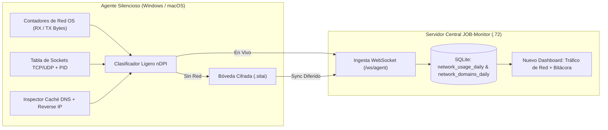

# Plan de Implementación: Telemetría de Red e Inspección de Dominios (Estilo `ntopng` Silencioso)

Este documento define la arquitectura, los alcances, las limitaciones técnicas y el desglose por **Fases y Mini-Funciones** para integrar un sistema de auditoría de tráfico de red y dominios en **SITAI JOB-Monitor**, operando **100% invisible en el equipo cliente (Windows y macOS)** y centralizando las estadísticas visuales en el **Servidor Central**.

---

## 1. Alcances del Sistema (¿Qué SÍ hará?)

1. **Cero Interfaz Gráfica en el Cliente (Modo 100% Headless / Silencioso):**
   - El empleado **no** tendrá ningún puerto web abierto en su PC (a diferencia del instalador estándar de `ntopng` que abre el puerto `3000`), ni verá iconos adicionales ni ventanas emergentes. Todo corre dentro del mismo proceso ligero de [agent.py](file:///Users/sitaidev/Library/Mobile Documents/com~apple~CloudDocs/Desktop/Max/JOB-Monitor/agent/agent.py).
2. **Medición Exacta de Ancho de Banda por Cliente (RX / TX):**
   - Contabilización continua de **Bytes / MB / GB descargados (`RX`)** y **subidos (`TX`)** por día y por equipo.
   - Cálculo de **velocidad en tiempo real** (`Mbps` / `Kbps` de bajada y subida) visible en el panel de administración.
3. **Descubrimiento de Dominios y Sitios Conectados (Incluso en Modo Incógnito):**
   - Inspección combinada de la caché DNS del sistema operativo (`ipconfig /displaydns` en Windows, `lsof`/`netstat` y resolución inversa en macOS) cruzada con las conexiones TCP/UDP activas (`ESTABLISHED` / `SYN_SENT`).
   - Registro de dominios raíz y subdominios (ej. `youtube.com`, `web.whatsapp.com`, `chat.openai.com`, `netflix.com`, `wetransfer.com`, `drive.google.com`).
4. **Asociación de Tráfico con Aplicación / Proceso Local:**
   - Identificación de qué ejecutable dentro del equipo originó la conexión de red (ej. `chrome.exe`, `msedge.exe`, `Safari`, `AnyDesk.exe`, `Spotify.exe`, `OneDrive.exe`).
5. **Clasificación Automática de Servicios (Estilo `nDPI`):**
   - Agrupación inteligente de dominios en categorías ejecutivas: `Streaming / Video`, `Redes Sociales`, `Mensajería`, `Inteligencia Artificial`, `Almacenamiento Cloud`, `Acceso Remoto`, `Desarrollo / Trabajo` y `Sistema / Actualizaciones`.
6. **Resiliencia Offline con Bóveda Cifrada (`.sitai`):**
   - Si el cliente pierde conexión con el servidor central, las métricas de consumo acumulados y los dominios detectados se empaquetan cifrados con RSA-2048 en archivos `.sitai` y se sincronizan al recuperar red.
7. **Nuevo Dashboard "Tráfico de Red" + Registro en Bitácora:**
   - Nueva pestaña dedicada en el servidor central con KPIs globales, tabla comparativa de clientes que más megas consumen, inspector de dominios por cliente y alertas automáticas en la **Bitácora de Eventos (`NETWORK`)**.

---

## 2. Limitaciones Técnicas (¿Qué NO hará y por qué?)

> [!IMPORTANT]
> Para mantener el agente **ultraligero, sin drivers invasivos de kernel (`Npcap`/`WinPcap`) y sin certificados raíz MITM** que rompan los navegadores del cliente, existen las siguientes fronteras técnicas:

1. **Se ven los Dominios (`youtube.com`), pero NO la URL interna cifrada (`youtube.com/watch?v=xyz`):**
   - En conexiones `HTTPS` (TLS 1.3), el nombre del dominio es público durante la resolución DNS y el saludo TLS, pero la ruta exacta después del `/` viaja cifrada. *(Sin embargo, en `JOB-Monitor` esto se complementa automáticamente con el título de la ventana activa y las capturas DVR WebP que ya tienes funcionando).*
2. **Conteo de Megas Exacto a Nivel Interfaz Física, y Estimado por Dominio:**
   - Sin instalar un driver de captura de paquetes en modo promiscuo (`Npcap`), el sistema operativo entrega el **100% exacto** de los MB/GB totales descargados y subidos por la tarjeta de red del cliente, y distribuye el peso de los dominios según la frecuencia, duración y actividad de los sockets abiertos por cada proceso.
3. **DNS sobre HTTPS (DoH) Puro en Navegadores con Caché Propia:**
   - Si un navegador tiene activado DNS cifrado privado externo sin pasar por el resolvedor del sistema operativo, algunas consultas no aparecen en `ipconfig /displaydns`. Para mitigar esto, el agente cruzará también las IPs remotas de los sockets activos mediante resolución inversa (`PTR` / caché ARP-DNS) y rangos de ASNs conocidos (Google, Meta, Netflix, Cloudflare, AWS).
4. **Tráfico de Otros Dispositivos de la Red (Celulares / Smart TVs):**
   - Como el agente vive dentro de cada PC/Mac monitoreada, mide exclusivamente el tráfico de **esos equipos** (no el de teléfonos móviles o impresoras donde no esté instalado el agente).

---

## 3. Arquitectura del Flujo de Datos

---

## 4. Desglose por Fases y Mini-Funciones

### FASE 1: Colector Silencioso de Red y Dominios en el Agente ([agent.py](file:///Users/sitaidev/Library/Mobile Documents/com~apple~CloudDocs/Desktop/Max/JOB-Monitor/agent/agent.py))
*Objetivo: Capturar bytes consumidos, velocidad actual, procesos y dominios conectados en Windows y macOS con 0% de impacto visual.*

- **Mini-Función `NF-1.1` (`get_network_io_counters`):**
  - Lee los contadores nativos de bytes recibidos (`rx_bytes`) y enviados (`tx_bytes`) de las interfaces físicas activas del sistema operativo:
    - En **Windows**: mediante la API nativa `iphlpapi.GetIfTable2` / `ctypes` (o contadores de interfaz excluyendo `Loopback`).
    - En **macOS**: mediante `netstat -ibn` / `sysctl` sobre interfaces activas (`en0`, `en1`, etc.).
- **Mini-Función `NF-1.2` (`BandwidthDeltaTracker`):**
  - Calcula en cada ciclo de telemetría (cada 4 segundos) el diferencial exacto `delta_rx_bytes` y `delta_tx_bytes`, así como la tasa instantánea `rx_bps` y `tx_bps` (para mostrar `Mbps` / `Kbps` en vivo), ignorando reinicios de interfaz o contadores negativos.
- **Mini-Función `NF-1.3` (`inspect_active_sockets_and_processes`):**
  - Obtiene las conexiones remotas `ESTABLISHED` en puertos web/servicios (`80`, `443`, `8080`, etc.) junto con su `PID` y nombre de aplicación (`chrome.exe`, `msedge.exe`, `Safari`, `AnyDesk`, etc.), filtrando tráfico local (`127.0.0.1`, `::1`, y la conexión propia hacia el servidor `JOB-Monitor` para no contaminar las estadísticas del empleado con el propio streaming del monitoreo).
- **Mini-Función `NF-1.4` (`harvest_dns_and_resolve_domains`):**
  - Extrae los nombres de dominio consultados recientemente:
    - En **Windows**: parsea silenciosamente `ipconfig /displaydns` (`CREATE_NO_WINDOW`) mapeando cada `Record Name` con su IP `A`/`AAAA` en una tabla hash en memoria.
    - En **macOS**: combina caché de conexiones con resolución inversa asíncrona con caché (`TTL` en memoria de 30 min para no repetir consultas).
- **Mini-Función `NF-1.5` (`classify_domain_ndpi`):**
  - Normaliza subdominios ruidosos (ej. `rr3---sn-ab5l6nzl.googlevideo.com` -> `youtube.com`, `scontent.fmex1-1.fna.fbcdn.net` -> `facebook.com`) y les asigna una categoría (`Video/Streaming`, `Redes Sociales`, `Mensajería`, `IA`, `Cloud`, `Trabajo`, `Otros`).
- **Mini-Función `NF-1.6` (`pack_network_telemetry_and_sitai`):**
  - Adjunta el resumen de red (`delta_rx_bytes`, `delta_tx_bytes`, `rx_kbps`, `tx_kbps`, `domain_hits`) al paquete de telemetría en vivo y al contenedor cifrado `.sitai` cuando el agente opera sin conexión.

---

### FASE 2: Persistencia y Motor de Agregación en Base de Datos ([database.py](file:///Users/sitaidev/Library/Mobile Documents/com~apple~CloudDocs/Desktop/Max/JOB-Monitor/server/database.py))
*Objetivo: Almacenar eficientemente en SQLite el consumo diario por cliente y el historial de dominios/aplicaciones sin inflar la base de datos.*

- **Mini-Función `NF-2.1` (`init_network_tables`):**
  - Crea automáticamente en SQLite dos tablas optimizadas con índices por fecha y `agent_id`:
    1. `network_usage_daily (date, agent_id, rx_bytes, tx_bytes, peak_rx_kbps, peak_tx_kbps, updated_at)`
    2. `network_domains_daily (date, agent_id, domain, app_name, category, hit_count, estimated_bytes, first_seen_at, last_seen_at)`
- **Mini-Función `NF-2.2` (`record_network_slice`):**
  - Hace `UPSERT` atómico de los bytes descargados/subidos por el cliente en el día actual y actualiza el pico de velocidad (`peak_rx_kbps` / `peak_tx_kbps`).
- **Mini-Función `NF-2.3` (`record_domain_activity_batch`):**
  - Registra o incrementa los dominios detectados en ese intervalo para el `agent_id`, acumulando `hit_count`, `estimated_bytes` (repartidos proporcionalmente entre las conexiones activas del intervalo), `app_name` y `last_seen_at`.
- **Mini-Función `NF-2.4` (`get_network_dashboard_summary`):**
  - Consulta consolidada para el Dashboard: devuelve el ranking de equipos ordenados por mayor consumo total (`rx_bytes + tx_bytes`), sus 5 dominios principales, y los totales globales de la empresa por fecha y `tenant_id`.
- **Mini-Función `NF-2.5` (`get_agent_domains_detail`):**
  - Consulta detallada de todos los dominios, categorías, aplicaciones y horarios registrados para un cliente específico (o todos los clientes) en una fecha seleccionada.

---

### FASE 3: Ingesta en Tiempo Real, Alertas en Bitácora y Endpoints API ([app.py](file:///Users/sitaidev/Library/Mobile Documents/com~apple~CloudDocs/Desktop/Max/JOB-Monitor/server/app.py))
*Objetivo: Procesar los flujos de red desde el WebSocket y desde archivos `.sitai`, disparar eventos relevantes en la Bitácora y exponer la API para el frontend.*

- **Mini-Función `NF-3.1` (`ingest_agent_network_telemetry`):**
  - En el bucle de `/ws/agent` (y en el descifrador de `sitai_encrypted_event`), recibe los datos de red del cliente, actualiza las propiedades en memoria (`agent.rx_kbps`, `agent.tx_kbps`, `agent.today_rx_bytes`, `agent.today_tx_bytes`) e invoca a `db.record_network_slice` y `db.record_domain_activity_batch`.
- **Mini-Función `NF-3.2` (`emit_network_domain_audit_logs`):**
  - Genera entradas automáticas (con *throttling* inteligente para no repetir el mismo dominio cada 4 segundos) en la **Bitácora de Eventos (`NETWORK`)** cuando:
    - Un cliente inicia actividad hacia un nuevo dominio destacado (ej. `Conexión detectada a 'youtube.com' via msedge.exe [Streaming / Video]`).
    - Un cliente supera un umbral de descarga/subida intensiva en un bloque corto.
- **Mini-Función `NF-3.3` (`GET /api/network/summary`):**
  - Endpoint autenticado con soporte Multi-Tenant que retorna los KPIs globales, el ranking de consumo por cliente y el Top de dominios/categorías del día.
- **Mini-Función `NF-3.4` (`GET /api/network/domains`):**
  - Endpoint autenticado con filtros por `date`, `agent_id`, `category` y búsqueda `q` para inspeccionar cada dominio conectado, proceso asociado, hora de primera/última conexión y tráfico estimado.
- **Mini-Función `NF-3.5` (`GET /api/network/export-csv`):**
  - Exportación en 1 clic a Excel (`.csv` UTF-8 con BOM) del reporte de consumo de megas y dominios visitados por cliente.

---

### FASE 4: Dashboard Visual "Tráfico de Red" en el Panel Web ([index.html](file:///Users/sitaidev/Library/Mobile Documents/com~apple~CloudDocs/Desktop/Max/JOB-Monitor/server/templates/index.html), [app.js](file:///Users/sitaidev/Library/Mobile Documents/com~apple~CloudDocs/Desktop/Max/JOB-Monitor/server/static/js/app.js), [styles.css](file:///Users/sitaidev/Library/Mobile Documents/com~apple~CloudDocs/Desktop/Max/JOB-Monitor/server/static/css/styles.css))
*Objetivo: Construir una interfaz ejecutiva estilo `ntopng` integrada nativamente en el diseño de SITAI JOB-Monitor (cero emojis, iconografía SVG limpia).*

- **Mini-Función `NF-4.1` (`Pestaña y Vista #view-network en index.html`):**
  - Agrega el botón **"Tráfico de Red"** en la barra de navegación superior y la sección `#view-network` con:
    - 4 Tarjetas KPI superiores: **Descarga Total (Hoy)**, **Subida Total (Hoy)**, **Equipo con Mayor Consumo**, y **Dominio / Servicio Principal**.
    - Selector de fecha, filtro por cliente, filtro por categoría (`Video`, `Redes Sociales`, `IA`, `Cloud`, etc.) y botón **Exportar CSV**.
- **Mini-Función `NF-4.2` (`Tabla Ranking de Consumo por Cliente`):**
  - Muestra cada equipo con barra visual de proporción de consumo, velocidad en vivo (`↓ Mbps / ↑ Mbps`), Descarga (`MB / GB`), Subida (`MB / GB`), Total y píldoras con sus Top Dominios del día.
- **Mini-Función `NF-4.3` (`Tabla Inspector de Dominios y Aplicaciones`):**
  - Tabla inferior (filtrable al hacer clic en cualquier cliente del ranking) que lista: **Dominio / Host**, **Categoría (Badge nDPI)**, **Aplicación / Proceso (`chrome.exe`, `Safari`, etc.)**, **Equipo (Usuario)**, **Tráfico Estimado / Conexiones** y **Última Actividad**.
- **Mini-Función `NF-4.4` (`Indicador de Consumo en las Cards del Muro en Vivo`):**
  - Añade un indicador compacto en las tarjetas del Muro y del Visor mostrando la velocidad de red actual y los MB/GB consumidos en el día por ese equipo.

---

## 5. Orden de Ejecución Propuesto

1. **Paso 1:** Implementar **Fase 1** en [agent.py](file:///Users/sitaidev/Library/Mobile Documents/com~apple~CloudDocs/Desktop/Max/JOB-Monitor/agent/agent.py) y verificar captura de bytes RX/TX + resolución de dominios en macOS y Windows.
2. **Paso 2:** Implementar **Fase 2** en [database.py](file:///Users/sitaidev/Library/Mobile Documents/com~apple~CloudDocs/Desktop/Max/JOB-Monitor/server/database.py) y **Fase 3** en [app.py](file:///Users/sitaidev/Library/Mobile Documents/com~apple~CloudDocs/Desktop/Max/JOB-Monitor/server/app.py).
3. **Paso 3:** Implementar **Fase 4** en [index.html](file:///Users/sitaidev/Library/Mobile Documents/com~apple~CloudDocs/Desktop/Max/JOB-Monitor/server/templates/index.html), [styles.css](file:///Users/sitaidev/Library/Mobile Documents/com~apple~CloudDocs/Desktop/Max/JOB-Monitor/server/static/css/styles.css) y [app.js](file:///Users/sitaidev/Library/Mobile Documents/com~apple~CloudDocs/Desktop/Max/JOB-Monitor/server/static/js/app.js).
4. **Paso 4:** Pruebas integrales, commit en rama `Max` y despliegue en caliente en el servidor central `192.168.103.72:5080`.
